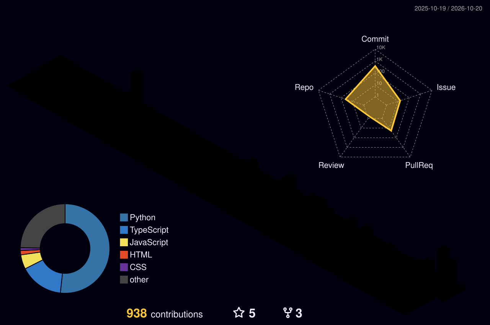

<p align="center">
  <a href="https://github.com/anand-esc">
    
  </a>
</p>

<p align="center">
  <a href="https://github.com/anand-esc"></a>
  <a href="https://github.com/anand-esc"></a>
  <a href="https://archlinux.org"></a>
  <a href="https://www.linkedin.com/in/suryansh-anand"></a>
</p>

<p align="center">
  <a href="https://www.linkedin.com/in/suryansh-anand" title="Click to connect on LinkedIn">
    
  </a>
</p>

---

### 📡 LIFETIME GITHUB CODE INTELLIGENCE & TELEMETRY

<p align="center">
  
</p>

<p align="center">
  <i>⚡ Auto-calculated &amp; verified across all repositories via automated CI/CD pipeline.</i>
</p>

---

### 💻 SYSTEM DIAGNOSTICS (`whoami.sh`)

<details open>
<summary><b>🔍 Executive Summary &amp; System Specs</b></summary>
<br/>

```ini
[DEVELOPER_PROFILE]
Name        = Suryansh Anand
Role        = AI/ML Systems Engineer & Full-Stack AI Developer
Affiliation = Google Gemini Student Ambassador
Education   = B.Tech Computer Science & Engineering (AI & ML) • Sri Sri University (3rd Year)
Location    = Cuttack, India
Focus Areas = Multi-Agent Swarms, Generative Adversarial Networks (GANs), Enterprise RAG, DevSecOps
Philosophy  = "The best way to predict the future is to engineer it."
```

- 🚀 **Specializing in**: Autonomous multi-agent pipelines, generative models (PyTorch GANs, Latent Space Exploration), and enterprise-grade vector RAG engines.
- 🌐 **Open Source & Research**: Contributing to **GSSoC 2026** and working as a **Citizen Scientist at IASC** (International Astronomical Search Collaboration).
- 🏆 **Track Record**: Previously engineered solutions with **1M1B Foundation (AICTE x IBM)** and **ServiceNow (SmartBridge)**.

</details>

---

### 🚀 FLAGSHIP INNOVATIONS & REPOSITORIES

<table width="100%">
  <tr>
    <td width="50%" valign="top">
      <h3>🛡️ <a href="https://github.com/anand-esc/frontend-nayayadarsi">Nyayadarsi</a></h3>
      <p><b>AI-Powered Tender Evaluation &amp; Procurement Compliance Engine</b></p>
      <p>An intelligent procurement integrity system designed to detect tender bid manipulation, enforce the L1 mandate, and ensure cryptographically backed legal transparency for public sector tenders.</p>
      <p>
        
        
        
      </p>
    </td>
    <td width="50%" valign="top">
      <h3>🧬 <a href="https://github.com/anand-esc/dcgan-mnist">DCGAN-MNIST</a></h3>
      <p><b>Deep Convolutional Generative Adversarial Network</b></p>
      <p>Clean PyTorch GAN implementation featuring label smoothing, latent space interpolation, tuned Adam optimizers, and automated real-time mode collapse detection telemetry in TensorBoard.</p>
      <p>
        
        
        
      </p>
    </td>
  </tr>
  <tr>
    <td width="50%" valign="top">
      <h3>⚖️ <a href="https://github.com/anand-esc/LawGeeks">LawGeeks</a></h3>
      <p><b>Dual-Engine Enterprise Legal AI Platform</b></p>
      <p>Real-time legal document intelligence providing streaming risk analysis, contract scoring, clause breakdown, and persistent vector memory for enterprise legal operations.</p>
      <p>
        
        
        
      </p>
    </td>
    <td width="50%" valign="top">
      <h3>🌿 <a href="https://github.com/anand-esc/EcoShield-Project">EcoShield</a></h3>
      <p><b>Autonomous Environmental Law Compliance Agent</b></p>
      <p>AI-driven compliance agent that automates complex multi-jurisdictional environmental regulations, environmental reporting, and liability risk assessments for growing businesses.</p>
      <p>
        
        
        
      </p>
    </td>
  </tr>
  <tr>
    <td width="50%" valign="top">
      <h3>💸 <a href="https://github.com/anand-esc/FinFlow">FinFlow</a></h3>
      <p><b>Autonomous Student Funding &amp; Verification Lifecycle</b></p>
      <p>Unified AI pipeline matching students to loans and scholarships, automating multi-document verification, and validating transparent funding pathways for first-generation learners.</p>
      <p>
        
        
        
      </p>
    </td>
    <td width="50%" valign="top">
      <h3>📄 <a href="https://github.com/anand-esc/karvex-resume-architect">Karvex Resume Architect</a></h3>
      <p><b>Vector-Optimized Career Intelligence Platform</b></p>
      <p>Instantly tailors engineering profiles to target Job Descriptions, dynamically scoring keyword density and generating ATS-optimized vector PDFs in real time.</p>
      <p>
        
        
        
      </p>
    </td>
  </tr>
</table>

---

### 🧠 TECHNICAL ARSENAL & CORE COMPETENCIES

<table>
  <tr>
    <th width="25%" align="left">Category</th>
    <th width="75%" align="left">Technologies &amp; Frameworks</th>
  </tr>
  <tr>
    <td><b>🧠 AI / Deep Learning</b></td>
    <td>
      
      
      
      
      
      
      
      
    </td>
  </tr>
  <tr>
    <td><b>🌐 LLM Platforms &amp; APIs</b></td>
    <td>
      
      
      
      
    </td>
  </tr>
  <tr>
    <td><b>⚡ Languages &amp; Systems</b></td>
    <td>
      
      
      
      
      
      
    </td>
  </tr>
  <tr>
    <td><b>🛠️ Full-Stack &amp; Frameworks</b></td>
    <td>
      
      
      
      
      
      
    </td>
  </tr>
  <tr>
    <td><b>☁️ DevOps, Cloud &amp; Infra</b></td>
    <td>
      
      
      
      
      
      
    </td>
  </tr>
</table>

---

### 🌐 3D SPATIAL CONTRIBUTION MATRIX

<p align="center">
  
</p>

<p align="center">
  <a href="https://github.com/anand-esc">
    
  </a>
</p>

---

### 📬 TRANSMISSION PORTAL & CONNECTIVITY

<p align="center">
  <a href="https://www.linkedin.com/in/suryansh-anand">
    
  </a>
  &nbsp;&nbsp;
  <a href="mailto:suryanshanand2210@gmail.com">
    
  </a>
  &nbsp;&nbsp;
  <a href="https://github.com/anand-esc">
    
  </a>
</p>

<p align="center">
  
</p>

```bash
suryansh@archlinux:~$ ./deploy_future.sh --autonomous --unconstrained
[SUCCESS] Pipeline executed in 0.042s. 1,325,472 lines compiled. System stable.
```
