<p align="center">
  
</p>

<p align="center">
  <code>AI/ML Engineer . Full Stack AI Developer . Google Gemini Student Ambassador</code>
</p>

<p align="center">
  <a href="https://www.linkedin.com/in/suryansh-anand"></a>
  <a href="#"></a>
  <a href="#"></a>
  <a href="mailto:suryansh.anand.dev@gmail.com"></a>
</p>

<p align="center">
  Building at the intersection of Generative AI, Multi-Agent Systems, and societal impact.<br>
  Contributing to GSSoC 2026 &middot; Citizen Scientist at IASC &middot; Previously at 1M1B Foundation (AICTE x IBM) and ServiceNow (SmartBridge)
</p>

```
B.Tech CSE (AI & ML)  .  Sri Sri University  .  3rd Year  .  Cuttack, India

core       Python, JavaScript, SQL
ai         LangChain, LangGraph, HuggingFace, RAG, GANs
platforms  Gemini API, OpenAI API, IBM Granite
web        React, Node.js, FastAPI, Tailwind
infra      GCP, Firebase, Docker, CI/CD, Linux
```

<p align="center">
  
</p>

<!-- 3D contribution graph (generated by the profile-3d-contrib workflow) -->
<p align="center">
  
</p>
