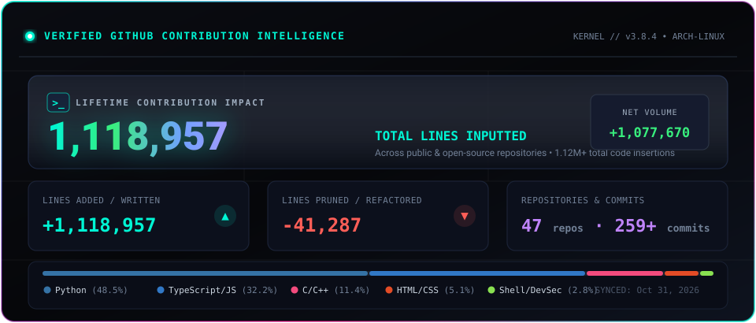

<div align="center">


<br>

<samp>AI/ML Engineer . Full Stack AI Developer . Google Gemini Student Ambassador</samp>

<br><br>

<a href="https://www.linkedin.com/in/suryansh-anand">
  
</a>
<a href="#">
  
</a>
<a href="#">
  
</a>
<a href="mailto:suryanshanand2210@gmail.com">
  
</a>

</div>

<br>

```
 B.Tech CSE (AI & ML)  .  Sri Sri University  .  3rd Year  .  Cuttack, India
```

<table>
<tr>
<td valign="top" width="50%">

**<samp>about</samp>**

Building at the intersection of Generative AI,
Multi-Agent Systems, and societal impact.

Currently contributing to GSSoC 2026 and
working as a Citizen Scientist at IASC.

Previously interned at 1M1B Foundation
(AICTE x IBM) and ServiceNow (SmartBridge).

</td>
<td valign="top" width="50%">

**<samp>stack</samp>**

**core** &mdash; Python, JavaScript, SQL

**ai** &mdash; LangChain, LangGraph, HuggingFace, RAG, GANs

**platforms** &mdash; Gemini API, OpenAI API, IBM Granite

**web** &mdash; React, Node.js, FastAPI, Tailwind

**infra** &mdash; GCP, Firebase, Docker, CI/CD, Linux

</td>
</tr>
</table>

<br>

<div align="center">
  
</div>
